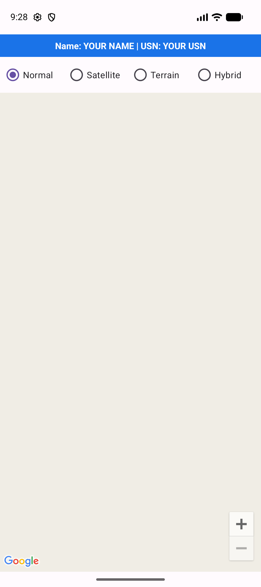
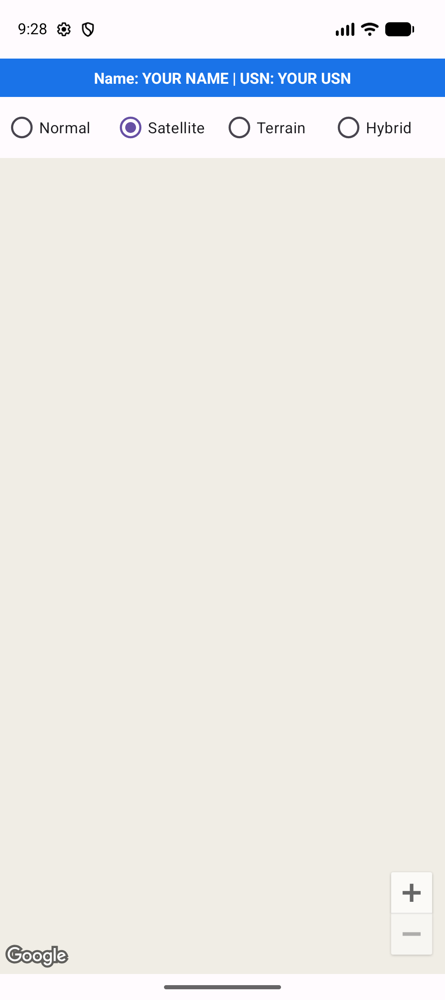
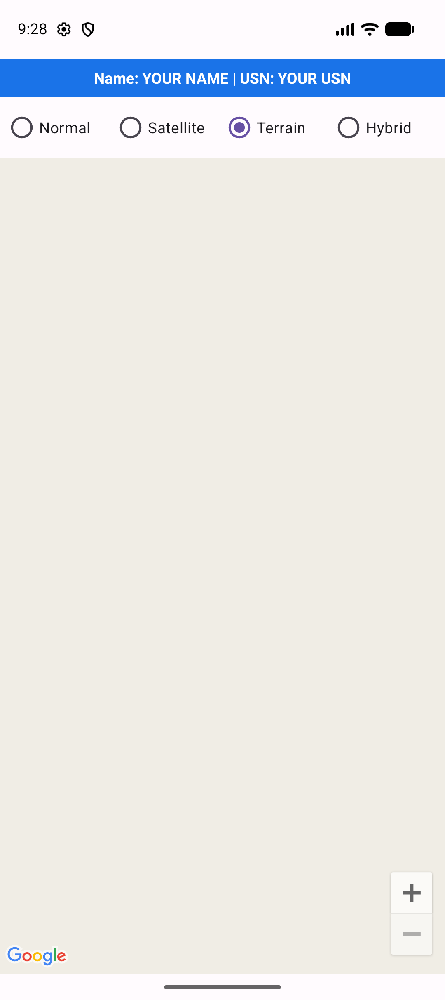

# Experiment 11 – Displaying Google Maps in an Android App

## Aim
Develop an Android application that displays a Google Map, places a marker on a location and lets the user switch between map types.

## Concept / Technology
- **Maps SDK for Android** (`com.google.android.gms:play-services-maps`) renders Google Maps tiles inside an app.
- **`SupportMapFragment`** hosts the map. `getMapAsync()` delivers a `GoogleMap` object through the `OnMapReadyCallback.onMapReady()` callback once the map is ready.
- **`GoogleMap`** is used to add a `Marker`, move the camera (`CameraUpdateFactory.newLatLngZoom`), change `mapType` and enable UI controls (zoom buttons, compass).
- **API key**: Maps requires a key from Google Cloud Console (enable *Maps SDK for Android*). It is supplied through `<meta-data android:name="com.google.android.geo.API_KEY">`.
  The key is read from `local.properties` (git-ignored) and injected as a manifest placeholder, so it is never committed.

## Scenario
A visitor opens the app and sees **Bengaluru (Vidhana Soudha)** marked on the map. Radio buttons let them switch between **Normal, Satellite, Terrain and Hybrid** views, and they can pan/zoom freely. A banner at the top shows the student's name and USN.

## Setup
1. Get a Maps SDK for Android API key (https://developers.google.com/maps/documentation/android-sdk/get-api-key).
2. Add to `local.properties`:
   ```
   MAPS_API_KEY=your_key_here
   ```
3. Put your details in `app/src/main/res/values/strings.xml` (`student_info`): `Name: ...  |  USN: ...`.
4. Open in Android Studio, run on an emulator image **with Google Play services** (Google APIs / Play Store).

## Project structure
```
pgm_11/
├── README.md
├── build.gradle.kts / settings.gradle.kts / gradle.properties
├── gradle/libs.versions.toml            # dependency versions (adds play-services-maps)
├── screenshots/                         # output + test case screenshots
└── app/
    ├── build.gradle.kts                 # reads MAPS_API_KEY, adds Maps dependency
    └── src/
        ├── main/
        │   ├── AndroidManifest.xml      # INTERNET permission + API key meta-data
        │   ├── java/com/example/pgm_11/MainActivity.kt   # map setup, marker, map-type switching
        │   └── res/
        │       ├── layout/activity_main.xml   # name/USN banner, map-type radios, map fragment
        │       └── values/strings.xml
        ├── test/.../ExampleUnitTest.kt             # local unit tests
        └── androidTest/.../ExampleInstrumentedTest.kt  # Espresso UI tests (TC1–TC3)
```

## Output


## Test cases
| # | Test case | Expected result | Screenshot |
|---|-----------|-----------------|------------|
| TC1 | Launch app (shows Name & USN banner) | Map centred on Bengaluru with marker; banner shows name and USN |  |
| TC2 | Select **Satellite** | Map switches to satellite imagery |  |
| TC3 | Select **Terrain** | Map switches to terrain view |  |

Automated versions: `./gradlew testDebugUnitTest` (unit) and `./gradlew connectedDebugAndroidTest` (UI, needs emulator).
